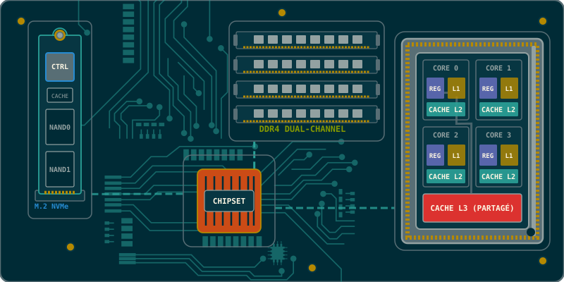

Un ordinateur est une **machine de calcul logique**. Contrairement à l'intuition humaine, il ne devine rien et n'improvise jamais : il exécute uniquement des opérations logiques et arithmétiques prédéterminées à une vitesse vertigineuse. Toutes ces instructions, ainsi que leurs résultats, sont représentés et stockés sous forme de **nombres binaires** (en base numérique 2, composée exclusivement de `0` et de `1`).

Pour transformer ces signaux électriques binaires en actions concrètes, l'architecture matérielle (*Hardware*) d'un ordinateur s'organise autour d'une distinction fondamentale :

::: {.row gap=4 mb=4}
:::: {.col span=6}
::::: {.card-window}
#### Les Composants (Sous le Capot) {.bi-cpu}

Ce sont les **organes vitaux internes** logés à l'intérieur du boîtier de l'ordinateur. Ils sont directement soudés ou enfichés sur un circuit imprimé central appelé la **carte mère**.

- **Exemples :** Processeur (CPU), barrettes de mémoire vive (RAM), disque SSD M.2, carte graphique PCI, puce BIOS/CMOS.
- **Rôle :** Exécuter les calculs, stocker les données et faire circuler les signaux à très haute fréquence.
:::::
::::

:::: {.col span=6}
::::: {.card-window}
#### Les Périphériques (À l'Extérieur) {.bi-usb-plug}

Ce sont les **organes externes** branchés par câble (ou sans fil) sur le panneau de connecteurs de l'ordinateur pour communiquer avec le monde extérieur.

- **Périphériques d'entrée :** Clavier, souris, microphone, webcam (envoient des données vers la machine).
- **Périphériques de sortie :** Écran (HDMI/DVI), casque audio (Jack), imprimante (restituent l'information).
- **Périphériques mixtes :** Clé USB, disque externe, câble réseau RJ45.
:::::
::::
:::

## 🧩 Anatomie Complète d'une Carte Mère

La **carte mère** (*Motherboard*) est la colonne vertébrale de l'ordinateur : c'est sur elle que viennent se greffer tous les composants internes et toutes les prises destinées aux périphériques externes.

::: {.card-window}
#### Radiographie Interactive de la Carte Mère {.bi-motherboard}

:::: {.tabs .mobo-anat-tabset}
##### Unité de Calcul (CPU) {.bi-cpu}

::::: {.row gap=3}
:::::: {.col span=8}
::::::: {.card}
**Organe n°12 — Socket CPU :** Le socle mécanique de haute précision qui accueille le **processeur (CPU)**, l'unité principale de calcul logique et arithmétique de l'ordinateur.
:::::::
::::::

:::::: {.col span=4}
::::::: {.card}
##### Rôle Clé {.bi-lightning-charge}

[]{.progressbar color='danger' data-progress=100}

*Cerveau logique* · [Calcul binaire]{.text-muted}
:::::::
::::::
:::::

##### Mémoire Vive (RAM) {.bi-memory}

::::: {.row gap=3}
:::::: {.col span=8}
::::::: {.card}
**Organe n°8 — Slots de Mémoire Vive (RAM) :** La mémoire de travail ultra-rapide du processeur. C'est une mémoire **temporaire (volatile)** : elle est intégralement effacée dès l'arrêt électrique de l'ordinateur.
:::::::
::::::

:::::: {.col span=4}
::::::: {.card}
##### Persistance {.bi-Exclamation-triangle}

[]{.progressbar color='warning' data-progress=10}

*Volatile* · [Effacée à l'arrêt]{.text-muted}
:::::::
::::::
:::::

##### Stockage Permanent (M.2) {.bi-nvme}

::::: {.row gap=3}
:::::: {.col span=8}
::::::: {.card}
**Organe n°10 — Port M.2 (Disque SSD) :** Emplacement compact directement câblé sur la carte mère pour accueillir un disque SSD moderne. Contrairement à la RAM, il assure le **stockage permanent** de votre système et de vos fichiers.
:::::::
::::::

:::::: {.col span=4}
::::::: {.card}
##### Persistance {.bi-database-check}

[]{.progressbar color='success' data-progress=100}

*Permanente* · [Conservée hors tension]{.text-muted}
:::::::
::::::
:::::

##### Chipset & Bus {.bi-diagram-3}

::::: {.row gap=3}
:::::: {.col span=8}
::::::: {.card}
**Organes n°7, n°9, n°11 & n°13 — Chipset, PCI, CMOS & Alimentation :** Le **Chipset (7)** connecte et orchestre tous les composants entre eux : ports d'extension **PCI (9)**, mémoire **CMOS/BIOS (11)** et connecteurs **5–12 V (13)**.
:::::::
::::::

:::::: {.col span=4}
::::::: {.card}
##### Interconnexion {.bi-bezier2}

[]{.progressbar color='info' data-progress=100}

*Chef d'orchestre* · [Flux de données]{.text-muted}
:::::::
::::::
:::::
::::

:::: {#info-motherboard-view .motherboard-view}
{.background}
::::

```{ojs}
//| echo: false
mutable infoMoboState = "cpu_reg"

_infoMoboTabWatcher = {
  const w = aptitek.createTabsetWatcher(
    ".mobo-anat-tabset",
    {
      "Unité de Calcul (CPU)": "cpu_reg",
      "Mémoire Vive (RAM)": "ram",
      "Stockage Permanent (M.2)": "ssd",
      "Chipset & Bus": "l3"
    },
    (val) => { mutable infoMoboState = val; }
  );
  invalidation.then(() => w.destroy());
  return null;
}

infoMoboComponent = aptitek.initInteractiveSvg("#info-motherboard-view", {
  tabsetSelector: ".mobo-anat-tabset",
  tabElementMap: {
    "part-cpu": "Unité de Calcul (CPU)",
    "cpu-core-0": "Unité de Calcul (CPU)",
    "cpu-core-1": "Unité de Calcul (CPU)",
    "cpu-core-2": "Unité de Calcul (CPU)",
    "cpu-core-3": "Unité de Calcul (CPU)",
    "part-ram": "Mémoire Vive (RAM)",
    "part-ssd": "Stockage Permanent (M.2)",
    "part-chipset": "Chipset & Bus"
  },
  states: ["cpu_reg", "ram", "ssd", "l3"],
  elementClasses: {
    "part-cpu": ["highlight-red"],
    "cpu-core-0": ["highlight-red"],
    "cpu-core-1": ["highlight-red"],
    "cpu-core-2": ["highlight-red"],
    "cpu-core-3": ["highlight-red"],
    "part-ram": ["highlight-green"],
    "part-ssd": ["highlight-blue"],
    "part-chipset": ["highlight-cyan"]
  },
  activeElementMap: {
    cpu_reg: ["part-cpu", "cpu-core-0", "cpu-core-1", "cpu-core-2", "cpu-core-3"],
    ram: ["part-ram", "part-cpu"],
    ssd: ["part-ssd", "part-chipset"],
    l3: ["part-chipset", "part-ssd", "part-ram", "part-cpu"]
  },
  flowMap: {
    cpu_reg: ["bus-cpu-internal", "bus-cpu-internal-6-5"],
    ram: ["bus-ram-chipset", "bus-chipset-ram", "bus-ram-cpu"],
    ssd: ["bus-ssd-chipset"],
    l3: ["bus-ssd-chipset", "bus-chipset-ram", "bus-chipset-cpu"]
  }
})

_infoMoboUpdate = { infoMoboComponent.update(infoMoboState); }
```
:::

### 🗺️ Répertoire des 13 Organes d'une Carte Mère Récente

Chaque prise externe (numéros **1 à 6**) et chaque emplacement interne (numéros **7 à 13**) remplit une fonction précise :

| N°     | Organe / Connecteur          | Famille                   | Rôle technique et caractéristiques                                                                                                 |
| :----- | :--------------------------- | :------------------------ | :--------------------------------------------------------------------------------------------------------------------------------- |
| **1**  | **Port vidéo DVI**           | Panneau Arrière (Vidéo)   | Interface vidéo numérique historique permettant de relier un moniteur ou un vidéoprojecteur.                                       |
| **2**  | **Port vidéo HDMI**          | Panneau Arrière (Vidéo)   | Standard haute définition transportant simultanément le signal vidéo numérique et le flux audio vers l'écran.                      |
| **3**  | **Port réseau RJ45**         | Panneau Arrière (Réseau)  | Prise Ethernet filaire assurant une connexion stable, rapide et à faible latence vers le routeur ou le réseau local.               |
| **4**  | **Port USB 3.0**             | Panneau Arrière (Données) | Connecteur universel à haut débit (souvent coloré en bleu) pour brancher clés USB, disques externes, clavier ou souris.            |
| **5**  | **Ports son Jack**           | Panneau Arrière (Audio)   | Prises cylindriques 3,5 mm dédiées aux périphériques audio analogiques (casque, enceintes, microphone).                            |
| **6**  | **Panneau de connecteurs**   | Interface Externe         | La façade arrière (*I/O Shield*) regroupant toutes les prises **1 à 5** accessibles hors du capot.                                 |
| **7**  | **Chipset**                  | Composant Interne         | Puce chef d'orchestre (souvent coiffée d'un radiateur) qui **connecte et fait dialoguer tous les composants entre eux**.           |
| **8**  | **Mémoire vive (RAM)**       | Composant Interne         | **Mémoire de travail temporaire** ultra-rapide. Elle stocke les programmes en cours mais est **effacée à l'arrêt**.                |
| **9**  | **Port PCI / PCIe**          | Composant Interne         | Connecteur long destiné aux **cartes d'extension** (carte graphique dédiée, carte Wi-Fi, carte son ou acquisition).                |
| **10** | **Port M.2**                 | Composant Interne         | Connecteur haute vitesse accueillant un disque SSD moderne pour le **stockage permanent** des fichiers et de l'OS.                 |
| **11** | **CMOS + Pile bouton**       | Composant Interne         | Puce contenant le **BIOS** (logiciel d'amorçage), alimentée en permanence par une pile bouton pour garder l'heure et les réglages. |
| **12** | **Socket CPU**               | Composant Interne         | Emplacement verrouillable recevant le **processeur (CPU)**, l'unité principale de calcul de la machine.                            |
| **13** | **Alimentations 5 V – 12 V** | Composant Interne         | Connecteurs électriques (24 broches ATX et 8 broches CPU) distribuant le courant continu régulé (5 V et 12 V).                     |

::: {.callout-note collapse="true"}
## 💡 Pourquoi y a-t-il une pile ronde sur une carte mère branchée au secteur ?
Même lorsqu'un ordinateur est totalement débranché de la prise murale pendant plusieurs mois, il conserve la date, l'heure exacte et l'ordre de démarrage des disques. C'est le rôle de la **pile CMOS (n°11, généralement une pile bouton CR2032 de 3 V)**. Si votre ordinateur perd soudainement l'heure ou affiche `CMOS Checksum Error` à chaque allumage après une coupure de courant, il suffit de remplacer cette pile !
:::

## ⚡ Alimentation Électrique & Sécurité Matérielle

L'électricité et la mémoire électronique exigent le respect de trois règles d'hygiène matérielle strictes pour éviter tout court-circuit ou toute corruption irréversible de vos fichiers.

::: {.row gap=4 mb=4}
:::: {.col span=4}
::::: {.card-window}
#### Intervention sous le Capot {.bi-plug}

Si vous devez ouvrir le boîtier pour nettoyer la poussière ou remplacer un composant :

1. Éteignez proprement l'ordinateur.
2. **Déconnectez tous les câbles au préalable** (câble secteur, mais aussi câbles d'écran HDMI/DisplayPort qui peuvent renvoyer un courant résiduel).
3. Maintenez le bouton d'allumage enfoncé 5 secondes à vide pour vider les condensateurs de la carte mère.
:::::
::::

:::: {.col span=4}
::::: {.card-window}
#### Ne Jamais Couper Avant l'Arrêt {.bi-power}

Il ne faut **jamais couper l'alimentation électrique** (bouton de multiprise ou prise arrachée) avant l'arrêt complet de l'ordinateur.

- Tant que le système tourne, des dizaines de fichiers sont ouverts en écriture.
- Une coupure brutale interrompt les opérations disques en plein vol et peut endommager le système de fichiers de démarrage.
:::::
::::

:::: {.col span=4}
::::: {.card-window}
#### Éjection des Clés USB {.bi-usb-drive}

Avant de débrancher une clé USB ou un disque externe, **pensez systématiquement à l'éjecter** dans votre explorateur de fichiers.

- Les systèmes d'exploitation utilisent un **cache d'écriture en RAM** : la barre de progression peut afficher 100 % alors que la clé est encore en train d'écrire physiquement les données.
:::::
::::
:::

::: {.callout-warning}
## ⚠️ Attention aux clés USB promotionnelles : risque de perte définitive !
Dans la mesure du possible, **évitez d'utiliser les clés USB promotionnelles** (oui, même celle offerte à la rentrée par l'université ou lors d'un salon professionnel !) pour stocker des documents importants.

Pour réduire les coûts à quelques centimes l'unité, ces clés sont fabriquées à partir de puces mémoire Flash déclassées (*rebuts de chaîne*) dépourvues de contrôleur de correction d'erreurs fiable. Elles présentent des **taux de défaut extrêmement élevés** et peuvent cesser de répondre du jour au lendemain sans aucun signe avant-coureur, entraînant la **perte définitive de vos données**.
:::

### 🧪 Simulateur Interactif : Diagnostic d'Alimentation & Intégrité USB

Sélectionnez un scénario matériel ci-dessous pour observer ce qui se passe réellement dans les circuits et la mémoire lors d'une manipulation :

::: {.card-window}
#### Banc d'Essai : Alimentation & Supports Amovibles {.bi-activity}

:::: {.tabs}
##### Scénario de Manipulation {.bi-sliders}

[Action Matérielle]{.select #hw_scenario_select options="Éjecter la clé USB avant de la retirer (Recommandé),Arracher la clé USB à chaud sans éjection (Risque),Arrêt logiciel propre avant de couper la multiprise,Coupure électrique brutale en pleine session,Stocker son mémoire sur une clé USB promotionnelle" value="Éjecter la clé USB avant de la retirer (Recommandé)"}
::::

:::: {#hw-sim-terminal .terminal}
#### Journal Matériel & Contrôleur de Stockage {.bi-terminal}
::::
:::

```{ojs}
//| echo: false
_hwSimulator = {
  hw_scenario_select;
  const term = aptitek.createTerminal("#hw-sim-terminal", { defaultPrompt: false, showCursor: false });

  if (hw_scenario_select.startsWith("Éjecter la clé USB")) {
    term.writeLine("[OS] Demande d'éjection reçue pour le volume USB (/dev/sdb1)...", { type: "info" });
    term.writeLine("[RAM -> USB] Vidage du tampon d'écriture (sync) : 14.2 Mo écrits sur la mémoire Flash.", { type: "info" });
    term.writeLine("[FS] Fermeture propre de la table d'allocation des fichiers et démontage du volume.", { type: "success" });
    term.writeLine("✅ [MATÉRIEL] Le périphérique peut être débranché en toute sécurité : 0 octet perdu.", { type: "success" });
  } else if (hw_scenario_select.startsWith("Arracher la clé USB")) {
    term.writeLine("[RAM -> USB] Copie de 'Projet_Final.pdf' : barre de progression à 100% (4.8 Mo encore en cache RAM)...", { type: "info" });
    term.writeLine("⚡ [ALERTE BUS USB] Déconnexion électrique brutale détectée sur le port USB 3.0 (Organe n°4) !", { type: "danger" });
    term.writeLine("[-] ERREUR E/S : Impossible d'écrire les derniers blocs sur la mémoire Flash NAND.", { type: "danger" });
    term.writeLine("⚠️ Résultat : Fichier PDF tronqué (0 octet ou illisible) et table de partition corrompue.", { type: "warning" });
  } else if (hw_scenario_select.startsWith("Arrêt logiciel propre")) {
    term.writeLine("[OS] Signal d'extinction envoyé à toutes les applications ouvertes...", { type: "info" });
    term.writeLine("[RAM -> M.2] Synchronisation des caches vers le disque SSD permanent (Organe n°10).", { type: "success" });
    term.writeLine("[ACPI] Signal Power-Off envoyé à l'alimentation 5-12V (Organe n°13).", { type: "success" });
    term.writeLine("✅ Machine éteinte proprement. La RAM (Organe n°8) se vide, le SSD conserve 100% des données.", { type: "muted" });
  } else if (hw_scenario_select.startsWith("Coupure électrique")) {
    term.writeLine("⚡ [COUPURE 12V/5V] Perte instantanée de tension sur les connecteurs d'alimentation (Organe n°13) !", { type: "danger" });
    term.writeLine("[-] Mémoire vive RAM (Organe n°8) : effacement immédiat de tout le travail non enregistré.", { type: "danger" });
    term.writeLine("[-] Disque M.2 (Organe n°10) : transaction journalisée interrompue (vérification fsck/chkdsk requise au prochain boot).", { type: "warning" });
  } else {
    term.writeLine("[AUDIT PUCE FLASH] Inspection de la clé USB promotionnelle (Contrôleur générique sans marque)...", { type: "info" });
    term.writeLine("[!] Puce NAND Grade-C détectée : 42 blocs défectueux dès la sortie d'usine.", { type: "warning" });
    term.writeLine("[-] Après 15 cycles d'écriture : défaillance du contrôleur mémoire -> Périphérique non reconnu.", { type: "danger" });
    term.writeLine("⚠️ Conseil : N'utilisez jamais une clé promotionnelle sans sauvegarde sur un disque ou cloud fiable !", { type: "warning" });
  }

  invalidation.then(() => term.destroy());
}
```
